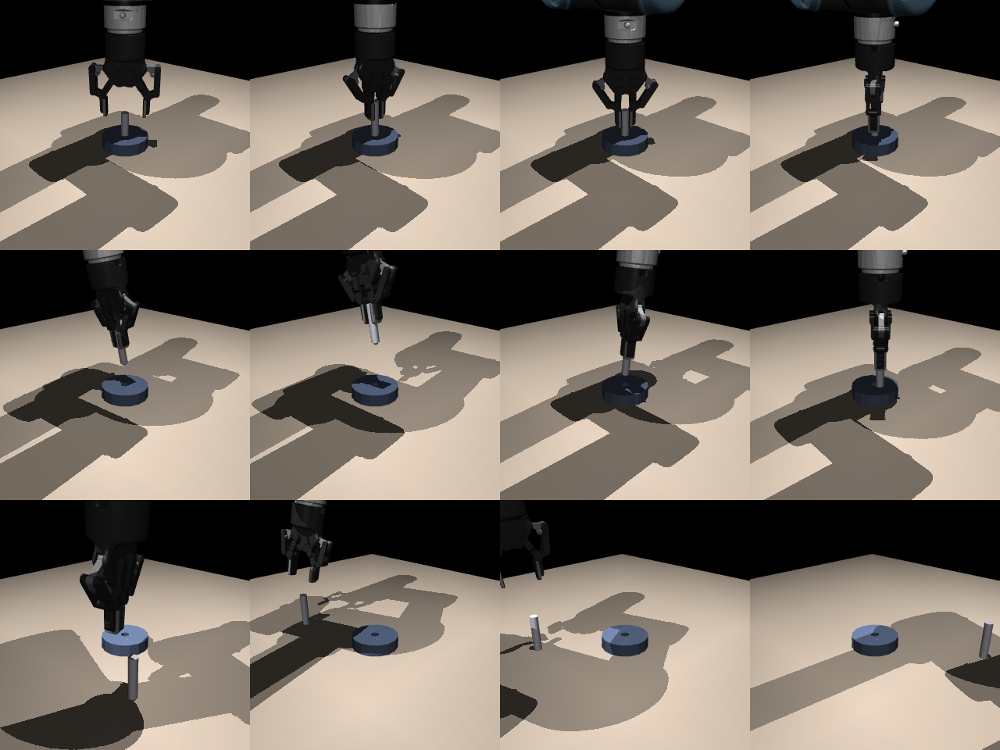

# sgs-rod

SGS start-state sampling ([arXiv 2610.12465](https://arxiv.org/html/2610.12465v1)) on UR5e + Robotiq 2F-85
rod-in-hole, in MuJoCo Warp. Design, sources and every assumption: [DESIGN.md](DESIGN.md).



## Setup

```sh
uv sync
uv run --no-sync pytest -q
```

On macOS with the project under an iCloud-synced folder, the editable-install `.pth` file gets the `hidden`
flag and Python skips it; tests set `pythonpath` themselves, and scripts need `PYTHONPATH=src`.

Robot models: MuJoCo Menagerie commit in `assets/MENAGERIE_COMMIT`, licenses kept beside each model.

## Layout

| Path | What |
|---|---|
| `src/sgs_rod/scene.py` | MuJoCo model: UR5e (torque motors, gravity compensated), 2F-85 (pad μ = 2), rod, bore |
| `src/sgs_rod/control.py` | Relative OSC as a Warp kernel |
| `src/sgs_rod/env.py` | Batched MuJoCo Warp environment (rsl_rl `VecEnv`): reward, success, failure, point cloud |
| `src/sgs_rod/generate.py`, `scripts/make_bank.py` | Start configurations: Near-Goal, Stable Grasp, Reaching |
| `src/sgs_rod/sampler.py` | SGS and uniform samplers |
| `scripts/train.py` | PPO training, held-out Reaching evaluation at every checkpoint |
| `scripts/pod_train.sh` | One-command run on a CUDA machine |
| `banks/` | Generated bank (`train.npz`, 32,768) and evaluation set (`eval.npz`, 1,024 Reaching) |

## Train

On a CUDA machine (e.g. a RunPod RTX 5090), from the repo root:

```sh
SAMPLER=sgs HOURS=6 bash scripts/pod_train.sh
```

It runs a 2-iteration check at full scale, then trains in the background. Logs go to `runs/<name>.log`,
checkpoints (policy `model_N.pt` + sampler `model_N.sgs.pt`) to `runs/<name>/`, every 100 iterations. The
uniform baseline is `SAMPLER=uniform`.

Graphs: TensorBoard event files are always written (`uv run tensorboard --logdir runs`). With `--wandb-project`
the run is also logged to W&B; the pod script uses offline mode, so upload afterwards with
`uv run wandb sync runs/<name>/wandb/offline-run-*` (needs `wandb login` once).

Logged per iteration: episode success and failure (overall and per family), the share of resets each family
gets, PPO losses; at every checkpoint: held-out Reaching success (deterministic policy) and SGS's per-family mean
success estimate.

Resume: `uv run --no-sync python scripts/train.py --resume runs/<name>/model_N.pt ...` (restores the sampler too).

## Status

- [x] Scene, controller, environment, bank, samplers, training script; tests pass; CPU smoke runs end to end
- [ ] First run on a CUDA GPU (the CUDA-graph path has not run yet; speed at 10,000 environments unknown)
- [ ] SGS vs uniform comparison
